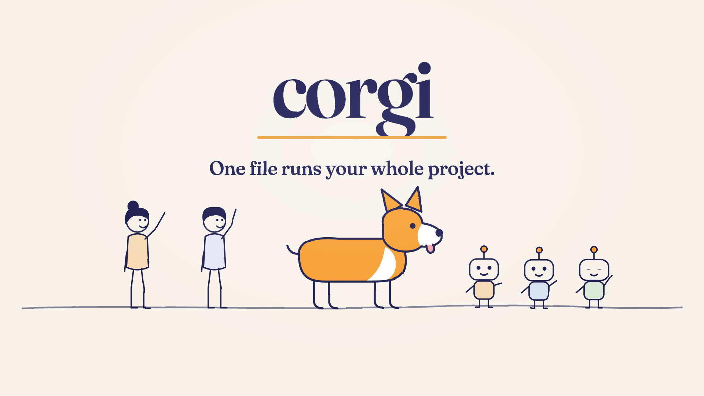
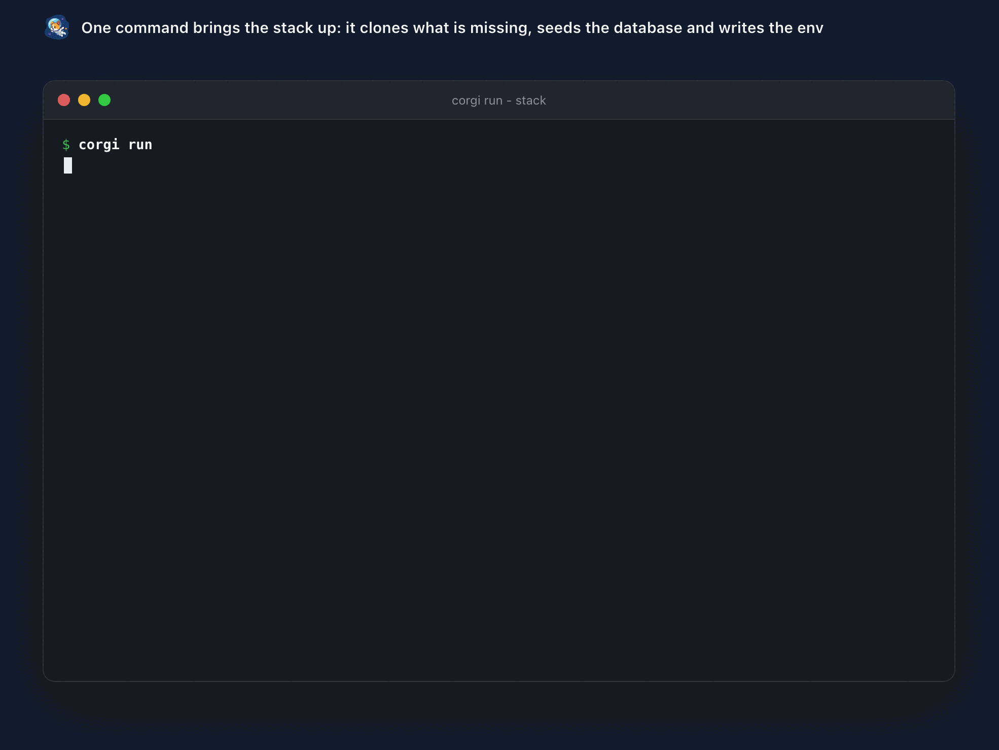
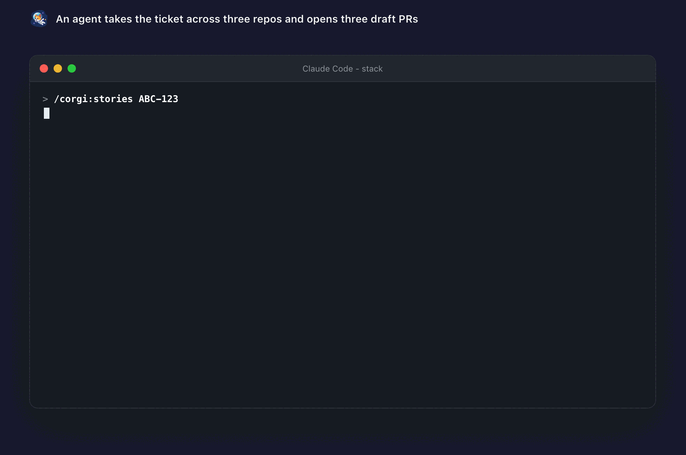
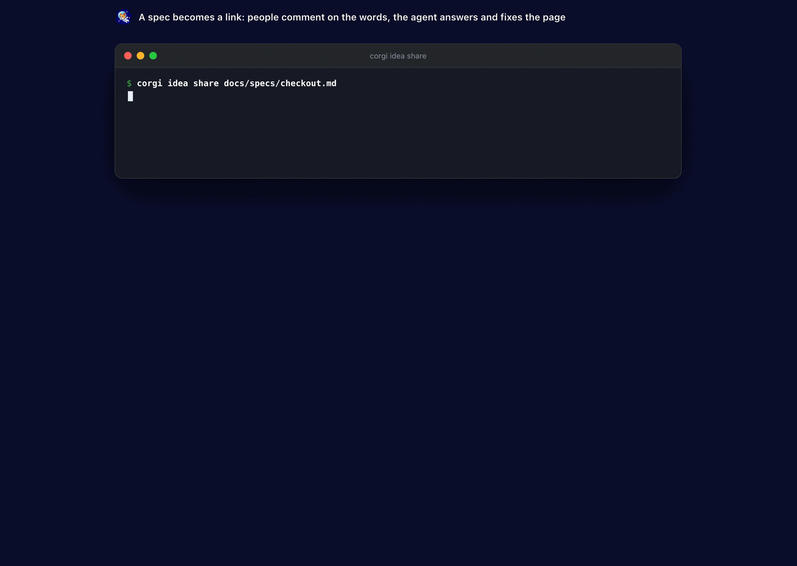
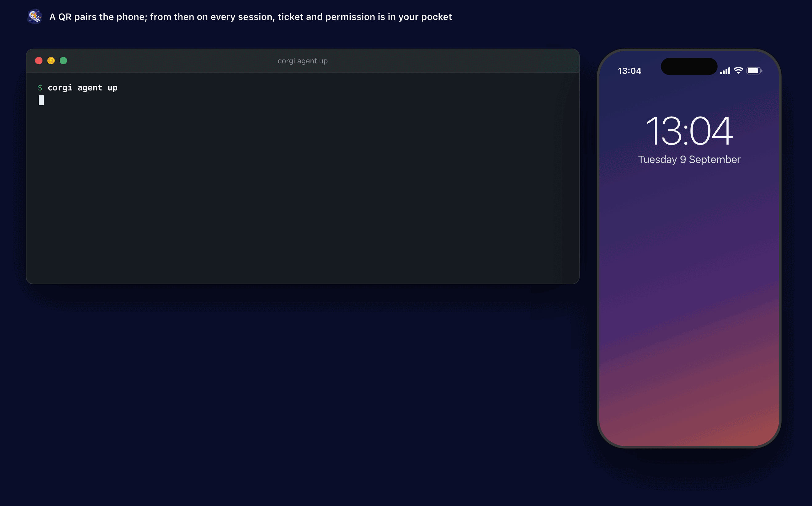
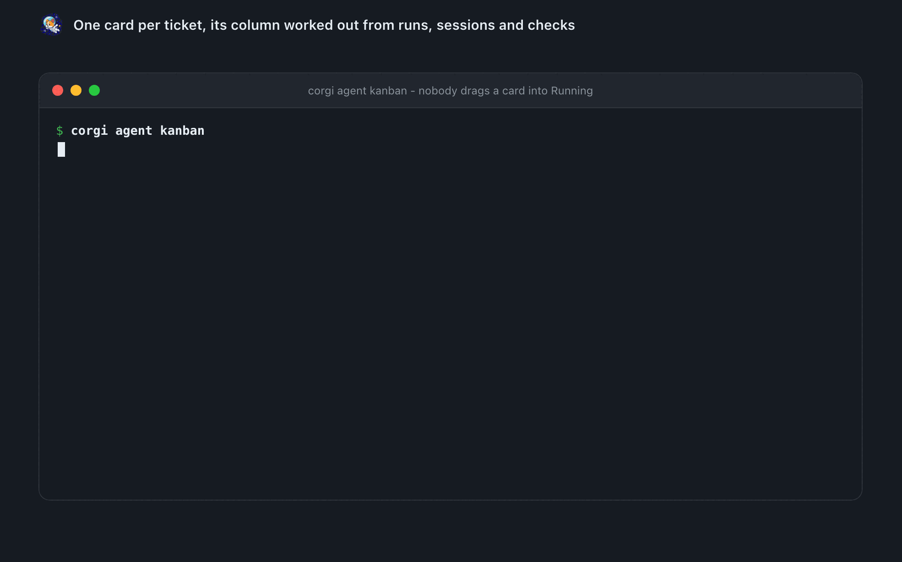

<div align="center">
  

  # 🐶 CORGI 🐶

  **One file runs your whole project.** Every repo, database, service, and the env vars between them. `corgi run` starts all of it. That same file is what your AI agents work in, what CI boots, and what your phone connects to.

  [](LICENSE)
  [](#install)
  [](docs/install.md)
  [](https://apps.apple.com/app/id6811009400)
  [](https://marketplace.visualstudio.com/items?itemName=Corgi.corgi)
  [](https://sonarcloud.io/summary/new_code?id=Andriiklymiuk_corgi)

</div>

A feature is rarely one repo. It's an API change, a web change, a mobile change, and a migration. corgi describes all of that in one `corgi-compose.yml` and runs it, so you can build the whole feature at once:

```text
                          ┌─ you       corgi run            whole stack up, one command
                          │
  corgi-compose.yml ──►   ├─ an agent  /corgi:stories        ticket ─► code ─► draft PR per repo
   (committed, shared)    │
                          ├─ your CI   corgi test --e2e      every repo's branch, one suite
                          │
                          ├─ your team corgi idea share      a spec ─► a link people comment on ─► the agent fixes it
                          │
                          └─ your phone  scan a QR           send work to this laptop from anywhere
```

<p align="center"><a href="docs/media/corgi-film.mp4"></a></p>
<p align="center"><sub>▶ <a href="docs/media/corgi-film.mp4">Watch the film</a> (under 2 minutes, with sound) · <a href="https://youtu.be/rlMCjs4EoFs?si=o3SQaymM55zxBCUY">the older screen recording</a></sub></p>

## Install

```bash
brew install andriiklymiuk/homebrew-tools/corgi
```

Homebrew 5 asks you to `brew trust andriiklymiuk/tools` once. No Homebrew? One line, checksum-verified:

```bash
curl -fsSL https://raw.githubusercontent.com/Andriiklymiuk/corgi/main/install.sh | sh
```

Windows, Scoop, mise, pkgx, shell completion: [full install guide](docs/install.md).

In Claude Code with the plugin, **`/corgi:setup`** installs the rest: VS Code extension, menu bar app, the daemon at login with a tunnel and the pairing QR, notifications, session tracking. It lists the few clicks only you can do.

## Quick start

```bash
brew install andriiklymiuk/homebrew-tools/corgi

corgi run -l        # browse runnable examples, pick one to try

# in your own project, next to a corgi-compose.yml:
corgi doctor        # check required tools, ports, docker
corgi run           # start every database + service, together
corgi status -w     # watch each service turn healthy
```

```text
corgi-compose.yml  ─►  corgi run
                         ├─ clone missing repos
                         ├─ start + seed databases (in Docker)
                         ├─ write + wire .env between services
                         └─ run services as host processes
                                    ↓
                         whole stack running 🐶   (Ctrl-C tears it all down)
```

> **Agents & CI:** use `corgi run --detach` then `corgi status --ready --timeout 2m` instead of the foreground commands above - they return instead of blocking. See [agents & scripting](docs/agents.md).

No `corgi-compose.yml` yet? `corgi create` writes a starter one, or `/corgi-new` writes one with Claude.

## What the file looks like

A seeded Postgres, a Go API that corgi clones for you, and a web app:

```yml
db_services:
  db:
    driver: postgres
    databaseName: app
    port: 5432
    seedFromFilePath: ./seed.sql            # loaded on first run

services:
  api:
    cloneFrom: https://github.com/acme/api.git   # cloned if ./api isn't there yet
    path: ./api
    port: 7012
    depends_on_db:
      - name: db                            # puts DB_HOST/DB_PORT/DB_NAME/... in api/.env
    start:
      - go run .
  web:
    cloneFrom: https://github.com/acme/web.git
    path: ./web
    depends_on_services:
      - name: api                           # puts api's URL in web/.env
    start:
      - yarn dev
```

`corgi run` clones what's missing, seeds Postgres, writes the `.env` files, then runs `api` and `web` together. `Ctrl-C` stops all of it. For every available field, run `corgi docs` or browse the [examples repo](https://github.com/Andriiklymiuk/corgi_examples).

## What you can do with it

Each row is one guide. Start with the first; read the rest when you need them.

| you want to | you type | guide |
| --- | --- | --- |
| run the stack, the databases, a feature branch across repos | `corgi run` · `corgi db -u` · `corgi run --feature ABC-123` | [Every day with corgi](docs/everyday.md) |
| give a ticket to an agent and get a draft PR per repo | `/corgi:stories ABC-123` | [Let an agent take a whole ticket](docs/ticket-to-pr.md) |
| turn a spec into a link your team comments on | `corgi idea share spec.md` | [Ideas](docs/ideas.md) |
| drive your laptop from your phone | `corgi agent up`, then scan the QR | [Code from your phone](docs/phone.md) |
| see every Claude session and answer the one that waits | `corgi agent track enable` | [Every session at once](docs/sessions.md) |
| have bugs, reviews and red builds handled while you are out | `corgi agent watch enable --action fix` | [Unattended work](docs/unattended.md) |
| choose how much runs without you | `corgi agent level 3` | [The ladder](docs/software-factory.md) |
| boot the whole stack in CI and run one e2e suite | `corgi run --feature $BRANCH --detach --wait` | [Run the stack in CI](docs/ci.md) |

### The stack, every day

<p align="center"></p>
<p align="center"><sub>One command brings the stack up: it clones what is missing, seeds the database and writes the env. <a href="docs/everyday.md">More →</a></sub></p>

### An agent takes the ticket

<p align="center"></p>
<p align="center"><sub>An agent takes the ticket across three repos and opens three draft PRs. <a href="docs/ticket-to-pr.md">More →</a></sub></p>

```
/plugin marketplace add Andriiklymiuk/corgi
/plugin install corgi@corgi
```

Other agents: `npx skills add Andriiklymiuk/corgi`. Nothing ships without you: it opens **draft** PRs and waits.

### A spec your team comments on

<p align="center"></p>
<p align="center"><sub>A spec becomes a link: people comment on the words, the agent answers and fixes the page. <a href="docs/ideas.md">More →</a></sub></p>

### Your laptop, from your phone

<p align="center"></p>
<p align="center"><sub>A QR pairs the phone; from then on every session, ticket and permission is in your pocket. <a href="docs/phone.md">More →</a></sub></p>

### A team of agents you can see

<p align="center"></p>
<p align="center"><sub>One card per ticket, its column worked out from runs, sessions and checks. <a href="docs/sessions.md">The board →</a> · <a href="docs/unattended.md">What it does on its own →</a></sub></p>

## The apps

| where | what |
| --- | --- |
| [iPhone](https://apps.apple.com/app/id6811009400) | the inbox, the board, every session with Allow/Deny, the lock screen |
| [Mac](https://apps.apple.com/app/id6811009400?platform=mac) | the menu bar and the window, over the same board |
| [VS Code](https://marketplace.visualstudio.com/items?itemName=Corgi.corgi) | the sessions view, a status bar item, a toast when a session waits |
| [Stream Deck](https://github.com/Andriiklymiuk/corgi-agent-deck) | one key per session, Talk, Prompt and Budget keys |
| Claude Code | the [corgi-band](plugins/corgi-band) and [corgi-guard](plugins/corgi-guard) mods ([what they do](docs/sessions.md#inside-claude-code-the-mods)) |
| any Claude | the daemon as an [MCP connector](docs/mcp.md#add-corgi-to-claudeai-desktop-or-the-phone) |

All of them read the board the daemon keeps. There is nothing to configure beyond the QR.

## Security & scope

- **corgi is not a deploy tool.** It runs and tests your stack on your laptop and in CI. Shipping to staging and prod stays with your CI/CD. If you already use `docker-compose`, keep it: corgi runs around your containers.
- A `corgi-compose.yml` runs its `start` commands on your machine, so only run files you trust. That goes double for `corgi run -t <url>`, which runs a file from somewhere else.
- `corgi doctor --fix` will start Docker for you, but **installing a tool or killing whatever holds a port always asks first** (or `--yes` in CI).
- `corgi mcp` is local stdio by default. `--http` is **unauthenticated**, so only expose it with `--tunnel`, which adds a bearer token. Treat that URL and token like a credential.
- **No telemetry.** The only call corgi makes on its own is `corgi update` checking GitHub for a newer release.

## Documentation

**Start**
- [Install](docs/install.md) · [Getting it running on a real project](docs/getting-started.md) · [Every day with corgi](docs/everyday.md)
- [Databases & drivers](docs/databases.md) · [Tunnels](docs/tunnel.md) · [Run in CI](docs/ci.md)

**Agents**
- [Let an agent take a whole ticket](docs/ticket-to-pr.md) · [Agents & scripting](docs/agents.md) (JSON, exit codes, errors) · [MCP server](docs/mcp.md)
- [Ideas](docs/ideas.md) · [Tracker planning](docs/tracker.md)

**Agent mode**
- [Code from your phone](docs/phone.md) · [Every session at once](docs/sessions.md) · [Unattended work](docs/unattended.md)
- [The ladder: how much runs without you](docs/software-factory.md) · [Agent mode, the whole reference](docs/agent.md)

Full docs site: https://andriiklymiuk.github.io/corgi/ · every compose field: `corgi docs` · examples: [corgi_examples](https://github.com/Andriiklymiuk/corgi_examples)

The pictures are drawn from the code's own strings: `make showcase` redraws the gifs, `make film` redraws the film.

[](https://sonarcloud.io/summary/new_code?id=Andriiklymiuk_corgi)
[](https://sonarcloud.io/summary/new_code?id=Andriiklymiuk_corgi)

If corgi saved you a day, [a star](https://github.com/Andriiklymiuk/corgi) helps other people find it. 🐶

## Credits

## Credits

- `corgi tunnel` defaults to [cloudflared](https://github.com/cloudflare/cloudflared) and its free [Quick Tunnels](https://developers.cloudflare.com/cloudflare-one/connections/connect-networks/do-more-with-tunnels/trycloudflare/). Thanks to Cloudflare. [ngrok](https://ngrok.com) and [localtunnel](https://github.com/localtunnel/localtunnel) also work.
- <a href="https://www.freepik.com/free-vector/cute-corgi-dog-astronaut-floating-space-cartoon-vector-icon-illustration-animal-science-icon-concept-isolated-premium-vector-flat-cartoon-style_22271104.htm#query=corgi%20icon&position=7&from_view=keyword">Corgi image by catalyststuff</a> on Freepik
