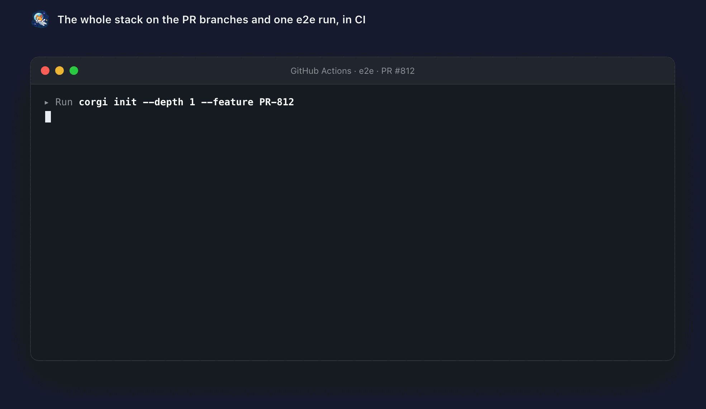

# Run the whole stack in CI

Each repo's pipeline only proves that repo works alone, so the bug that only shows up in the combination still ships. corgi's CI job starts the whole stack from the branches under review and runs one e2e suite against it.

corgi detects CI and runs non-interactive. With the official action the job is a few lines:

```yaml
- uses: Andriiklymiuk/corgi@v2                     # install corgi
- run: corgi init --depth 1 --feature "$BRANCH"    # shallow-clone every repo with the change
- uses: Andriiklymiuk/corgi/cache@v2               # cache plan hashed from the cloned lockfiles
  id: cache
- uses: actions/cache@v4
  with:
    path: ${{ steps.cache.outputs.cache-paths }}
    key: ${{ steps.cache.outputs.cache-key }}
- run: corgi run --feature "$BRANCH" --detach --wait   # boot the stack, block until healthy
- run: corgi test --e2e                            # one e2e suite across the live stack
```

`--feature` tests each PR against the exact combination it will ship into. `--wait` blocks until every service is healthy, so there is no `sleep 60` in your pipeline. The cache plan comes after `corgi init` on purpose: its keys are hashed from the services' lockfiles, which do not exist until they are cloned. Full guide: [Run the stack in CI](https://andriiklymiuk.github.io/corgi/docs/ci).

<p align="center"></p>

---

[← Back to the README](../README.md)
