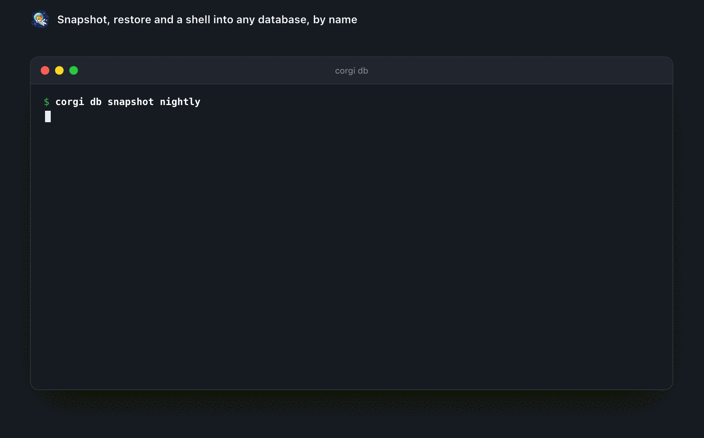
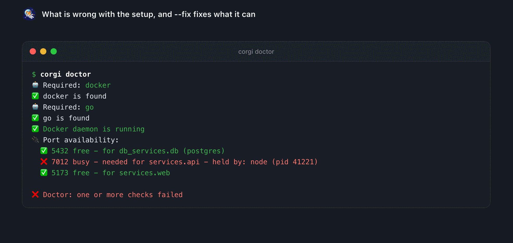
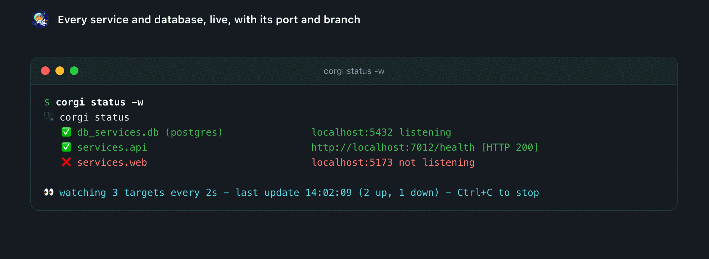
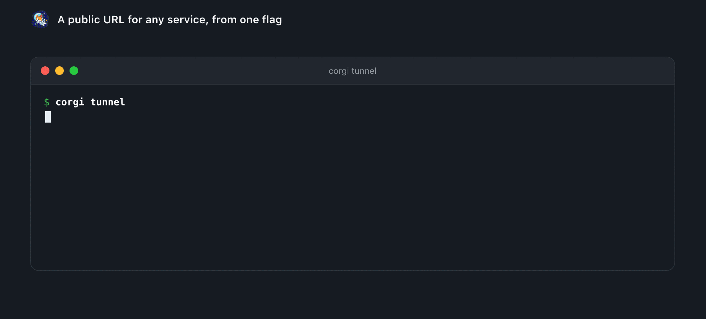
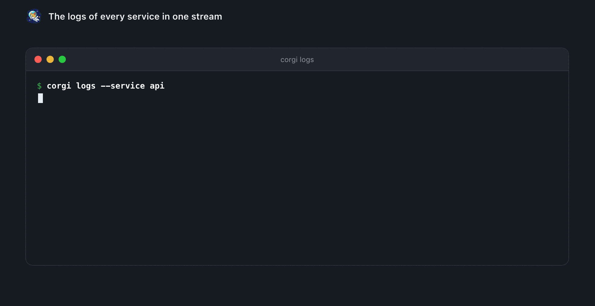
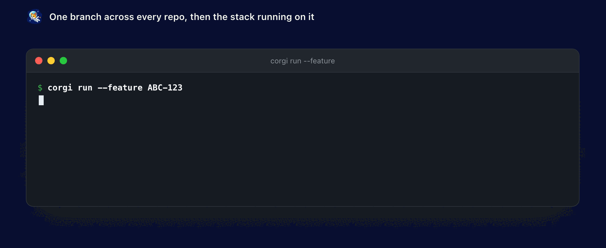

# Every day with corgi

One committed `corgi-compose.yml` describes the project. After that, the things you actually do in
a day are one command each:

| what you want | what you type |
| --- | --- |
| the whole stack up: repos cloned, databases seeded, env wired | `corgi run` |
| a feature that spans `api`, `web` and `mobile` | `corgi run --feature ABC-123` |
| a teammate's branch, in one service only | `corgi run --service-branch api=fix/login` |
| just the databases, to write a migration against | `corgi db -u` |
| the bug reproduced on yesterday's data | `corgi db restore nightly` |
| a public HTTPS URL for a webhook or a device | `corgi tunnel` |
| the same stack in CI, on the branches under review | `corgi run --feature $BRANCH --detach --wait` |
| an agent to take the ticket across every repo | `/corgi:stories ABC-123` |
| your laptop still working while you're out | `corgi agent up`, then scan the QR |
| which of your Claude sessions is waiting on you: menu bar, VS Code, Stream Deck | `corgi agent track enable` |
| a new bug or a PR review handled while you are away | `corgi agent watch enable --action fix` |
| how much runs without you, set per workspace | `corgi agent level`, `corgi agent level 3` ([the ladder](software-factory.md)) |
| the next project tomorrow | the same commands, in its folder |

The part that changes how you work is the second row. A feature that touches three repos normally
means three checkouts, three terminals and a lot of hoping. `--feature ABC-123` runs every repo
that has that branch and leaves the rest on `main`, so the mobile app calls the real endpoint,
which reads the real seeded database, on your laptop. You see the whole feature work before you
open a PR.

The rest of the list is why it stays installed: databases you can seed, snapshot and restore, env
files written for you, health you can watch, logs kept after the process dies, and the same five
commands on every project instead of a bespoke `make dev` per repo. Your
[agent](ticket-to-pr.md), your [CI](ci.md) and your
[phone](phone.md) drive that same file.

If you already use `docker-compose`, keep it. corgi runs the repos, seed data, env files and tool
checks around your containers. 

## The rest of the commands

Beyond the ones above, these are the ones that come up in a normal week:

| command | what you get |
| --- | --- |
| `corgi run --tier staging` | local services pointed at your staging env tier |
| `corgi db shell` | a native `psql`/`mysql` shell with the password already filled in |
| `corgi db snapshot` | freeze the current database state so you can come back to it |
| `corgi exec api -- go test ./...` | a one-off command in that service's directory and env |
| `corgi logs --service api` | logs kept after the process is gone |
| `corgi status -w` · `corgi ps` | health and run state while you work |
| `corgi mc` | one pane: each service's run state with its branch, PR and CI |
| `corgi open web` | opens the localhost URLs in the browser |
| `corgi doctor --fix` | missing tools, busy ports, Docker not running |
| `corgi idea new "…" [--type spec\|hld\|rfc\|<yours>] [--from doc.md]` · `idea open\|comment\|approve\|decide\|mock\|tickets\|build\|send\|history` | one page per thing to build or decide: written by the agent, commented by anyone with the link, answered live, split into tickets, built from or sent to Jira/Linear/Confluence ([above](ideas.md)) |
| `corgi memory list` | decisions and incidents the team commits next to the code |

38 database drivers ([list](databases.md)), and all of this behaves the same whether the
project has one service or twelve.

<p align="center"></p>

<p align="center"> </p>

<p align="center"></p>

<p align="center"></p>

<p align="center"></p>

Private repos, prerequisites, secrets or staging tiers? See
[Getting it running on a real project](getting-started.md).

## Working across many repos

corgi treats your repos as part of the stack, not as something you keep in sync on the side.

- **Auto-clone** - `cloneFrom:` clones a service when its folder is missing. A plain `path:` (a monorepo subfolder, or a repo you manage yourself) runs in place. You can mix both.
- **`corgi pull`** pulls every repo at once. **`corgi fork`** forks them to your account.
- **`corgi checkout main`** puts every repo back on `main` and fast-forwards it. A repo that calls its trunk something else falls back to its own default branch, and a repo with uncommitted work is skipped, not clobbered.
- **Run one service on a branch**, without editing the file:

```bash
corgi run --service-branch api=feature/login   # api's branch in its own worktree
corgi run --feature ABC-123                     # every repo that has the branch joins in
```

`--feature` takes one branch name. Every repo that has that branch runs from a worktree, and the rest stay where they are. Good for testing a PR branch, or for letting an agent work on a branch while you keep running `main`.

<p align="center"></p>

---

[← Back to the README](../README.md)
