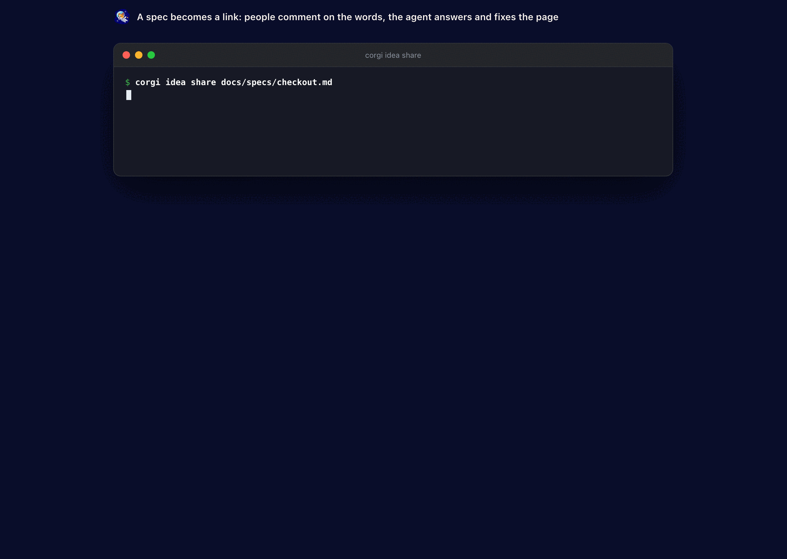

# Ideas - a page your team comments on, the agent keeps true, then builds

<p align="center"></p>
<p align="center"><sub>A spec becomes a link: people comment on the words, the agent answers and fixes the page.</sub></p>

The software factory idea, in corgi's words: you say what you want, the agent writes the page, people argue on the page, the agent keeps it true, and when it reads right the same page becomes the board and the build. One command, one page, no jargon:

```bash
corgi idea new "a scheduling app for a coffee shop"
corgi idea share docs/specs/checkout.md     # a spec you already have: the link for the team, copied
```

Already brainstormed a spec with your agent? Say "give me a link for the team": the file becomes a page word for word, the link is on your clipboard, people comment without an account, the agent answers each comment and fixes the page - and the fix lands back in your file.

The agent (Claude Code or Codex, whichever the workspace runs) names the project, tags it, writes the page - what it is, who uses it, screens, data, a concrete infra choice, open questions, the first tasks - puts those tasks on the board under the page's name and tags, and leaves two or three **proposals** on the page as comments: an alternative stack, a feature to cut, a risk it saw.

```text
corgi idea new "…"
   │
   ▼
the page (markdown, on your disk)  ◄──  highlight words, comment, attach a sketch
   ├─ in the browser     corgi idea open brewshift   (same port as the dashboard; the link is shareable)
   ├─ in VS Code         right-click any .md: Open in Corgi Preview; threads in the editor
   ├─ on the Mac         the Ideas tab, Share copies the link
   ├─ on the phone       the Ideas tab, Share opens the share sheet
   └─ the agent answers every comment, amends the page where asked, keeps the Tasks list in step
                                                            │
                                               Build it  ◄─┘  tasks on the board → a plan → the daemon builds, a worktree and a PR per task
```

- **Highlight to comment.** Select words on the page and say what should change. The comment remembers the words (with a little context either side), so it stays put when the page is rewritten.
- **Statuses, kept honest.** A comment is *open* until the agent reads it; *answered* when it replied; *fixed* when it changed the page for it (the reply says what and where); *resolved* when you close it. Reopen any time; the agent takes another look.
- **Proposals.** The agent's own suggestions sit in the thread as proposals. *Accept* and it does the work on the page; *dismiss* and it is gone.
- **Files and links.** Attach a screenshot, a sketch, a competitor's link; they ride with the comment and the agent sees them.
- **Live, everywhere.** The browser, VS Code and the phone follow the page as it changes - a comment from one shows on the others within a second, the agent's answer too.
- **Shareable.** The browser link carries a key: anyone you send it to reads and comments, no login - and only that: building, sending and sharing stay yours. `corgi idea share <slug | file.md>` prints and copies it (through the tunnel when `corgi agent up` runs one, else it says the link works on this Mac only), `--off` closes it, `--rotate` gives it a new key.
- **Your file stays the source.** A page shared from a file is updated by sharing the file again (same link), and the agent's fixes are written back to the file - unless you edited the file since, then your edit wins.
- **Videos and pictures.** `` plays in the browser, VS Code, the Mac and the phone; a file next to the spec travels with the link (inside the repository only, up to 40 MB each). YouTube, Loom and Vimeo links play where they are.
- **It rings.** Every comment, answer and page change rings on the desktop and the notifyUrl - Telegram for most. `corgi idea notify off` keeps idea pages quiet.
- **Build it.** The button at the end of the page (or `corgi idea build <slug> --workspace api`) hands the page to the agents: a planner cuts it into tasks on the board, a plan works through them in order, the daemon starts the first - the same unattended run a ticket gets, a worktree and a pull request per task. The page says what happened.

- **Sign-off.** *Looks good* in the page's header signs it off for the text as it reads now; anyone with the link can. When enough people have - one by default, `corgi idea set <slug> --approvals 2` for more - the page is **approved**. A change to the text after that asks for the sign-offs again, so an approval always means "this text". `corgi idea set <slug> --build-when-approved on` hands the page to the agents the moment it is approved, so the last "looks good" starts the build. `corgi idea approve <slug>` (`--undo`) does the same from a terminal.
- **Decisions.** Resolving a thread writes one line under *Decisions* at the end of the page: the first sentence of the agent's answer, or "Not doing: …" for a proposal nobody took. Reopening the thread takes its line back. The agent reads the decisions before it answers, so a settled thing stays settled. `corgi idea decide <slug>` lists them; `"…" --thread 4` rewords one; `"…"` adds one of your own; `--drop 2` removes one.
- **Show me: a clickable mockup.** *Show me* (or `corgi idea mock <slug>`) has the agent draw the page's screens as one HTML file - every screen the page names, clickable, with sample data in the product's own words. It sits under the page in a sandbox: its scripts cannot read the page, the key or your token, and cannot call out. *Comment on the mockup* leaves a note on it; when the agent answers, it draws the mockup again with the notes in.
- **Comment where you read.** Highlight words and a comment box opens right under them, focused - type, ⌘↵, done; the words stay marked while you write. On a phone a sheet comes up from the bottom instead, and follows the selection while you move its handles. A click or tap anywhere else closes it (what you typed is kept for those words). Paste a picture into any comment or reply, or attach one with 📎; links in comments are clickable. Each comment's time copies a link straight to it (`#c12`), and comments that came in since your last visit carry a bar.
- **Safe to share.** The link's key is 128 bits. `corgi idea share <slug> --for 7d` makes it stop working in a week (sharing again gives a fresh one), `--read-only` lets people read but not write, `--off` closes it, `--rotate` replaces it. Comments through the link say *via link* (the name is what the person typed), and one address may write 20 times a minute. Only you delete a comment. A sign-off through the link counts, but *build when approved* waits for your own. The page is never indexed by search engines, never sends its address to another site, runs only its own script, and cannot be framed; attachments run nothing. The agent that answers comments, writes pages and draws the mockup has no tools at all and runs in an empty folder: a comment cannot make it read a file, run a command or change your code.
- **Notifications your way.** `corgi idea notify on` rings for each comment and answer (the default); `corgi idea notify batch --every 10m` sends one summary instead - "Checkout: comment by max ×3, answered 2 comment(s)"; `off` keeps idea pages quiet.
- **Agents take part too, from anywhere.** The link works for an agent as it does for a person. `corgi idea show "<link>"` reads someone else's page with every thread; `corgi idea comment "<link>" "…" --quote "…" --by maria-agent` comments on its words; `corgi idea follow "<link>"` (or a slug here) prints every new version, comment, reply, sign-off and decision as it lands - `--json` for one line per change, `--notify` for a desktop notification. MCP `corgi_idea_read` and `corgi_idea_comment` take the link in place of a slug. An agent without corgi reads `…/idea/<slug>/agent?k=…`: the page as markdown, its threads, and the HTTP calls to comment, reply, sign off and follow (`/stream`, server-sent events). The page itself says so in a line at the bottom, for agents that fetch the link.
- **Your team's own page types.** `.corgi/idea-templates/prd.md` in the repository is `corgi idea new "…" --type prd`: the agent writes the page in that file's shape - its headings, in order, each one written through, the template's own instructions left out. `corgi idea templates` lists them. A built-in type's name (spec, hld) is never taken over.
- **The morning message.** The daily digest (`digestAt` in the agent config, and the phone's brief) lists the pages that wait on you: answers nobody closed, proposals nobody took, sign-offs still missing.
- **Not only ideas.** `--type spec` writes a feature spec for an existing product (goals, stories, flows, changes, rollout), `--type hld` a design (architecture, components, data, failure and scale, alternatives), `--type rfc` a proposal to decide on. `--from doc.md` keeps a page you already wrote and only names, tags and splits it.
- **Tickets, collapsed.** Every page ends with the agent's split into tickets - what, how one knows it is done, which waits for which - kept in step with the page as comments change it. Build it uses that split; so does **Send to Jira / Linear** (an epic with one ticket under it per line, with the watch's credentials) and **Send to Confluence** (the page itself). Each ticket shows its ref and state once it is on the board or in the tracker.
- **Reads fast.** A progress bar as you scroll, an outline of the sections with their open comments, a reply box under every thread (Enter sends), a "+ comment" on every heading, a share button, and a menu of every page at `/idea/` (and an Ideas tab on the dashboard).
- **Every version kept.** Each change to the page files the version before it, with who changed it and why ("agent: answered comment 3", "andrii: edited"); `corgi idea history <slug>` lists them, `--rev N` prints one, `corgi idea edit <slug> --from page.md` replaces the text and keeps the version before, and the clients show what moved.
- **From a session.** The `corgi:idea` skill and the MCP tools `corgi_idea_list`, `corgi_idea_read`, `corgi_idea_new`, `corgi_idea_comment`, `corgi_idea_edit`, `corgi_idea_resolve`, `corgi_idea_decide`, `corgi_idea_mock`, `corgi_idea_build`, `corgi_idea_send` let Claude Code or Codex write a page, answer its comments and act on it from inside a conversation.

Everything is files: `idea.md` (edit it in any editor; the browser follows), `meta.json` (name, tags, type, the split, where it was sent) and `comments.json` with every comment, reply and answer, in the agent directory (`corgi idea path <slug>`). The terminal does it all too: `corgi idea comment brewshift "use postgres" --quote "sqlite"` (`--prefix`/`--suffix` pick the right spot when the words are on the page twice), `corgi idea resolve brewshift 3`, `corgi idea tickets brewshift`, `corgi idea set brewshift --name Rota --tags rota,coffee --workspace api`, `corgi idea send brewshift --to linear`, `corgi idea answer brewshift` for one pass of the agent by hand, `corgi idea watch` to keep answering on a machine without the dashboard.
