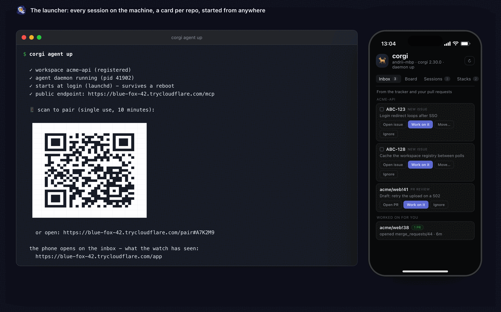
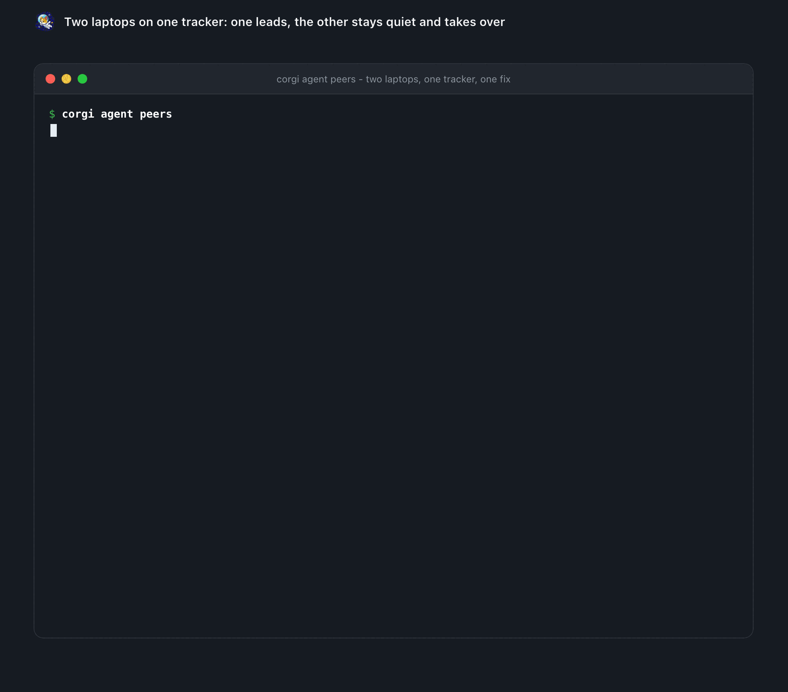
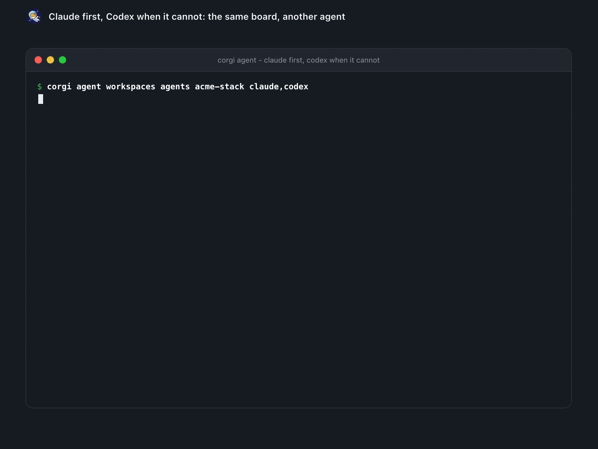

# Code from your phone

Run `corgi agent up` on your laptop and scan the QR once. Your phone now has a
launcher: every repo you registered, one tap each. Tap one and a Claude Code
session starts on the laptop - your files, your databases, your credentials - and
you drive it and answer its permission prompts from the phone. The branch is
waiting when you get back to the desk.

That one command is the whole setup, and it works in a corgi stack **or any git
repo**:

```text
$ corgi agent up

  ✓ workspace registered
  ✓ agent daemon running
  ✓ tunnel  https://…trycloudflare.com
  ✓ pairing open · scan with your phone to pair

  █▀▀▀▀▀█  ▀ ▀▄▄ ▀  █▀▀▀▀▀█
  █ ███ █  ▀ ▄▄ ▀▄  █ ███ █
  █ ▀▀▀ █  ▄▄█▄▄▄ ▀ █ ▀▀▀ █
  ▀▀▀▀▀▀▀ ▀ ▀▄█▄█▄▀ ▀▀▀▀▀▀▀
   ▄▄▄▄▄▀  ▄█ ▀▄██▄▄ ▄▄  ▄ 
   ▀▄ ██▀▀ ▄██▀ █████ ▄▄   
  ▄█▄ ▀ ▀▄▄▄ ▀ ▄ ▀▄▀██▀▄ █▀
   ▄▀▄▄▀▀▀▄ █▀█▄▀███    ▀ █
   ▀▀   ▀  ▄▀ ▄▄█ █▀▀▀█▀ █▀
  █▀▀▀▀▀█    ▄ ▀▄ █ ▀ █▀█▄ 
  █ ███ █  ██▀ █ ▀█▀▀█▀▄▀▄▀
  █ ▀▀▀ █  ▄██ ▄▄█▀▀▀ ▀█▄▀ 
  ▀▀▀▀▀▀▀  ▀ ▀▀▀ ▀▀ ▀  ▀ ▀ 
```

```text
📱 scan QR ──► launcher (one URL, all workspaces)
                 ├─ dev-stack   [open in: app]     ──► Claude app
                 └─ client-app  [open in: chrome]  ──► Chrome (its own account)
```

One scan pairs the phone. It gets its own token, revocable without touching your other devices. Each workspace remembers where it should open - personal projects in the Claude app, a work repo on a different Claude account in Chrome signed into that account. Save the launcher to your home screen and it is one tap after that.

<p align="center"></p>
<p align="center"><sub>The launcher: every session on the machine, a card per repo, started from anywhere.</sub></p>

## Adding your other repos

`agent up` registered the directory you ran it in, and the launcher lists only what is registered. Add the rest:

```bash
cd ~/dev/api && corgi agent init          # register this repo and enable it
corgi agent init --config-dir ~/.claude-work   # …under a different Claude account

corgi agent scan ~/dev                    # find repos under a folder and register them
                                          # (registers only; enable each with agent init)

corgi agent workspaces                    # list them · forget <id> drops one
```

`agent init` writes `.corgi/agent.yml` in the repo. It carries identity only, so it is safe to commit:

```yaml
version: 1
workspace:
  id: acme-stack
  aliases: [acme, recipe app]
```

Which Claude account it runs under, and whether it starts on its own, live in your own machine's config instead - a cloned repo can never decide that. The new repo shows up in the launcher on the next refresh; no re-pairing.

## What corgi is doing for you

The session itself is Claude's own
[Remote Control](https://code.claude.com/docs/en/remote-control) - corgi
reimplements none of it, and never asks you to start it. What corgi adds is
everything that has to be true before a phone is any use:

- **It is running when you are not there.** `corgi agent up --at-login` brings the daemon, the endpoint and the tunnel back at login, so the laptop answers after a reboot without you having set anything up before you left. Sessions come back after a crash, and a wake lock stops the laptop sleeping through a long task. If one dies anyway, `corgi agent brief` says where it stopped and which repo it left dirty. The supervised servers wait as **devices**, not as pre-opened conversations, so a restart leaves no empty `corgi · main · 10:00` rows in your session list - a session exists once you start one, from the launcher or the Claude app.
- **Every repo, on its own Claude account.** One launcher lists them all. Personal projects open in the Claude app; a work repo opens in Chrome signed into the work account.
- **One branch across the whole stack.** A session is not stuck in one directory: corgi puts the same branch in every repo that has it, and hands back a single diff over all of them - readable on the phone with no tunnel and nothing running.

## Keeping the same URL

By default `agent up` opens a free Cloudflare quick tunnel, and that URL is different every time it restarts - so the bookmark on your phone goes stale and you re-pair. Pick one of these instead, once:

```bash
# phone on the same Wi-Fi: no tunnel at all, nothing public
corgi agent up --http 0.0.0.0:8765          # save http://<your-lan-ip>:8765/app

# a domain you own, on a free Cloudflare account
cloudflared tunnel login
cloudflared tunnel create corgi-agent
cloudflared tunnel route dns corgi-agent corgi.yourdomain.com
corgi agent tunnel setup corgi.yourdomain.com   # remembered from now on

# no domain, still permanent
corgi agent tunnel setup <yours>.ngrok-free.dev --provider ngrok
```

`agent tunnel setup` stores the choice, so plain `corgi agent up` keeps using it after that. Because the origin stops changing, the phone stays paired across restarts and reboots - save `https://<your-host>/app` to the home screen and it keeps working.

## Two laptops, one phone

Each laptop gets a tunnel and a hostname of its own (`home.yourdomain.com`, `work.yourdomain.com` - one Cloudflare account, one domain; `tunnel setup` names the tunnel after the laptop). Pair the phone with both and it introduces them to each other; from then on the two daemons pulse each other every minute and, for every tracker both watch, **one leads** - it starts the fixes and rings you, the other stays quiet and takes over when the leader sleeps. `corgi agent peers` shows who is awake, who leads, and what the other laptop is on or failed at; `corgi agent sessions` lists the other laptop's sessions under your own. A laptop whose login lapsed or whose window is spent never leads while the other can, and the one with more budget wins a tie - so the laptop that sits at home for weeks keeps working, or hands over, without you. `corgi agent peers lead` pins it (the phone has the same switch in Settings). By hand: `corgi agent peers invite` on one, `corgi agent peers join <url> <code>` on the other. A peer's token opens two routes on the other laptop - its pulse and the pair-back - nothing else.

<p align="center"></p>
<p align="center"><sub>Two laptops on one tracker: one leads, the other stays quiet and takes over.</sub></p>

## More than one agent

A workspace names the agents it tries, in order:

```bash
corgi agent workspaces agents acme-stack claude,codex   # claude runs; codex when claude cannot
corgi agent workspaces agents --default claude,codex    # every workspace without an order of its own
corgi agent init --agents claude,codex                  # from the start
```

Claude Code is the default. With an order, every unattended run - a fix, a bot, a routine - picks the first agent that can work *right now*: installed, logged in, window not spent. When Claude's five-hour window runs out the next comment does not wait until it resets; Codex takes that run, under its own login, and your phone hears once a day that the work moved. The pick is not remembered, so Claude gets the next run back the moment its window opens. Two laptops see it too: a laptop with a fallback that can run never tells its peer it is unwell. `corgi agent workspaces` shows each order and what is not installed; `corgi agent doctor` fails when a first choice is missing. `corgi agent codex` opens Codex in this folder's workspace the way `corgi agent claude` opens Claude Code - same checkout, same flags - and `corgi agent claude` itself opens the first agent of the order that is installed. `corgi agent track enable` writes Codex's hooks (`~/.codex/hooks.json`, trusted once in Codex's `/hooks`), so its sessions land on the same board as Claude's - every prompt, tool, permission and stop, the terminal it runs in, its context and its summary - and the phone can focus, answer and type into it the same way; an older Codex without hooks gets the `notify` line and one row per turn. Codex's own rate-limit window is read from its sessions too: a spent Codex hands the run to the next agent in the order, as a spent Claude does. A workspace with `dangerouslySkipPermissions` opens Codex without approvals too, the way `codex --dangerously-bypass-approvals-and-sandbox` does by hand. A session can hand its work to the other agent - `corgi agent carry k3 --to codex`, or "Hand to codex" on the phone and the Mac - a fresh session in the same workspace with the handoff packet as its first prompt, allowed only where the workspace lists that agent. The next agent is one more entry in the harness table.

<p align="center"></p>
<p align="center"><sub>Claude first, Codex when it cannot: the same board, another agent.</sub></p>

`corgi agent down` turns everything off, and nothing runs again until you start it. macOS and Linux - a headless server too, where the phone and Telegram are the screen ([running it on a server](agent.md#running-it-on-a-server)). With the plugin, `/corgi-remote` walks you through the whole setup. Full guide: [docs/agent.md](agent.md).

## Talk to your laptop from any Claude

The same daemon is an MCP connector for Claude.ai, Claude Desktop and the
Claude phone app - the whole stack as 52 tools, behind your own sign-in:

```text
$ corgi agent status
corgi agent running (pid 84639, version 2.30.0)
  launcher   https://<host>/app
  connector  https://<host>/mcp   add in Claude: Connect, or No sign-in + Authorization: Bearer <device token>
```

In Claude: *Add custom connector* → paste the connector URL → **Sign in now**
→ **Add**. corgi opens its own consent page; approve it in a browser that has
seen `corgi agent dashboard`, or run `corgi agent approve ABCD-2345` on the
laptop. Then ask Claude *"what's running in my stack?"*, *"tail the api
logs since 10 minutes"*, *"start a session on the billing repo and fix the
failing test"*. Read-only tools just run; destructive ones ask first, and
`corgi_exec` stays off over a public tunnel. Revoke any time with
`corgi mcp devices revoke`. Details: [docs/mcp.md](mcp.md#add-corgi-to-claudeai-desktop-or-the-phone).

---

[← Back to the README](../README.md)
