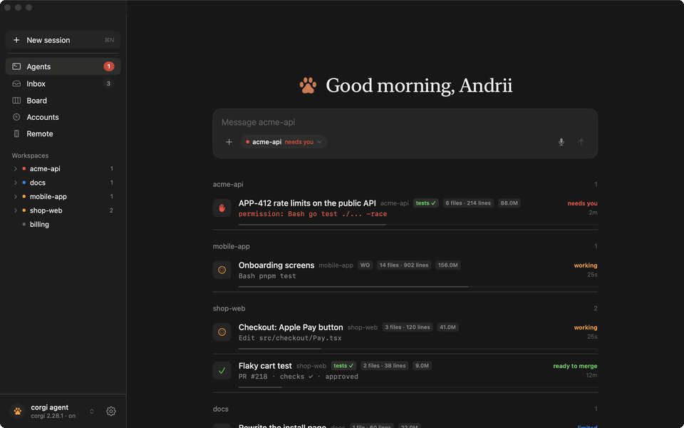
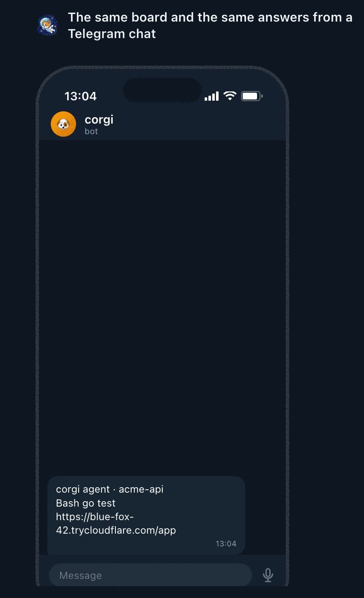
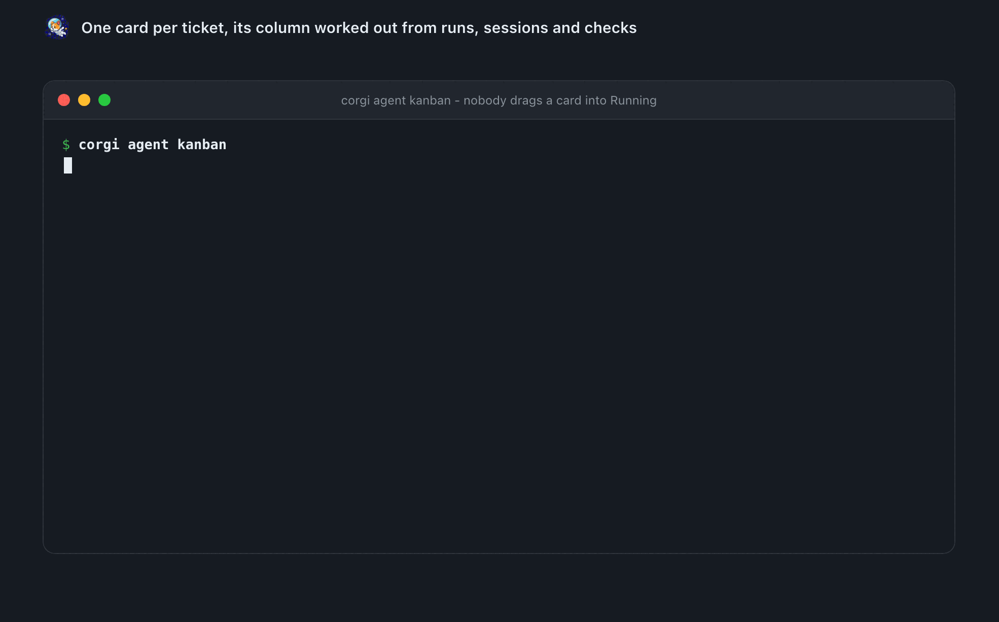

# See every Claude session at once

`corgi agent track enable` hooks into Claude Code. The daemon then keeps a
board: every session on the machine, its window and tab, whether it works,
waits for you, finished or hit the usage limit, its context fill, what it
does right now. Three clients show it:

| client | what it adds |
|---|---|
| [**Corgi Agents for Mac**](https://apps.apple.com/app/id6811009400?platform=mac) (menu bar + window; on the Mac App Store) | a desktop chat app over the board: sessions by workspace with Allow/Deny, a composer that dictates (Apple speech, no permissions games), takes photos and files, and sends to a session, a bot, a new chat in any workspace or the chief; workspace pages, the inbox, the kanban, accounts with a forecast |
| [VS Code extension](https://marketplace.visualstudio.com/items?itemName=Corgi.corgi) | Agent sessions view, status bar item, a toast with Go when a session in another window waits |
| [Corgi Agent Deck](https://github.com/Andriiklymiuk/corgi-agent-deck), Stream Deck | one key per session, Talk, Prompt and Budget keys |
| [corgi-band](../plugins/corgi-band) mod, inside Claude Code | a band above the prompt with the sessions waiting on you and what this turn posted; `/corgi` opens the board in a pane |

<p align="center"></p>
<p align="center"><sub>The Mac menu bar app: home, dictation, a workspace, the board, the inbox, the accounts.</sub></p>
<p align="center"></p>

<p align="center"></p>

## Inside Claude Code: the mods

Two small mods put corgi on the Claude Code screen itself. A mod is not a skill: the model does not read it, it runs beside the session.

**corgi-band** shows what needs you, without leaving the chat:

```
◐ ABC-8 stories waits on you: Bash git push            [Focus]
this turn: ✓ moved ABC-1 → Code review · ✗ Slack post (token_revoked)
```

- **Line one:** another session stopped on a question or a permission. **Focus** jumps to it.
- **Line two:** what this turn sent to people - Slack posts, ticket moves, comments, pull request actions, pushes. A tick when it worked, a cross and the reason when it did not. A failure pops up too.
- **Status line** `corgi · 2 waiting on you · 5h 91%`, only when something waits or the 5-hour budget is past 80%.
- **`/corgi`** opens the board in a pane: every live session, the tickets that want a person (**Work on it** opens a session on one), the stack of this folder, the budget.

**corgi-guard** stops shell commands that waste an agent's turns, and tells it the corgi way instead:

- `set -- $pair` in zsh, which leaves the second word empty.
- `rm -rf` on corgi's worktrees, which a hardened workspace refuses anyway.
- After a known error - an empty GraphQL variable, "no checks reported" right after a push, a dead Slack token - it adds the fix to what the agent reads.

```
/plugin install corgi-band@corgi
/plugin install corgi-guard@corgi
```

They all run the same commands:

```bash
corgi agent sessions --watch            # the board
corgi agent focus acme-api              # that window, that tab
corgi agent send acme-api --enter "run the tests"
corgi agent answer acme-api allow       # the permission prompt it waits on
corgi agent usage                       # every account: windows and forecast
corgi agent carry acme-api --profile work   # continue under another account
corgi agent standup                     # yesterday, from sessions and git
corgi agent watch enable --labels bug --prs --action fix   # new bugs and PR reviews: tell me, or fix them
```

A Telegram bot has the same: reply to a "needs you" message to type into
that session, `/allow`, `/sessions`, `/usage`. Details in
[docs/agent.md](agent.md#sessions-on-a-stream-deck).

<p align="center"></p>

## A team, not a pile of tabs

Plan → implement → review → merge, with a coding agent on each step and you on the phone.
corgi runs every Claude Code session on your laptop as a team you can see: a worktree per
task, a kanban worked out from the pull request's own checks and reviews, one word on every
row that says where it stands, and Allow, Deny, Send, Merge from the menu bar, the editor,
a Stream Deck or your phone - end-to-end encrypted, through your own machine.

```text
  ticket / prompt ─► corgi agent watch --action fix     a session per ticket, in its own worktree
                          │                              (--slots 3 runs three side by side)
                          ▼
              sessions.json ── the board ──► menu bar · VS Code · Stream Deck · corgi agent top
                          │                              needs you / working / ready to merge …
                          ▼
                  the phone: Allow · Deny · talk to it · explain this diff · merge
                          │
              checks ✓ + approved ──► auto-merge (opt-in), a red build rerun once first
```

- **One standing per session, card and inbox row** - *needs you*, *checks failing*, *ready to
  merge* - worked out once by the daemon from the session, its tests and the forge, so the phone
  never disagrees with the menu bar.
- **A worktree per task** (`--isolate`), **N at once** (`--slots`), a **token budget** per session,
  per workspace per day, and **carry to the next account** when one hits its limit - every switch
  off by default.
- **Feedback closes the loop on its own** - a review comment, a red build, a merge conflict is typed
  into the session that owns the branch (`--hand-over`); a red build is rerun once before anyone is
  told (`--rerun-ci`).
- **From the phone**: dictate a message, answer permissions one card at a time, have the chief
  explain a diff in three lines, open the app the agent built, keep chatting after the terminal is
  gone (`--headless`).

`corgi agent track enable` starts it. [The whole board contract →](agent.md)

<p align="center"></p>
<p align="center"><sub>One card per ticket, its column worked out from runs, sessions and checks.</sub></p>

What the team does while you are away: [unattended work](unattended.md).

---

[← Back to the README](../README.md)
