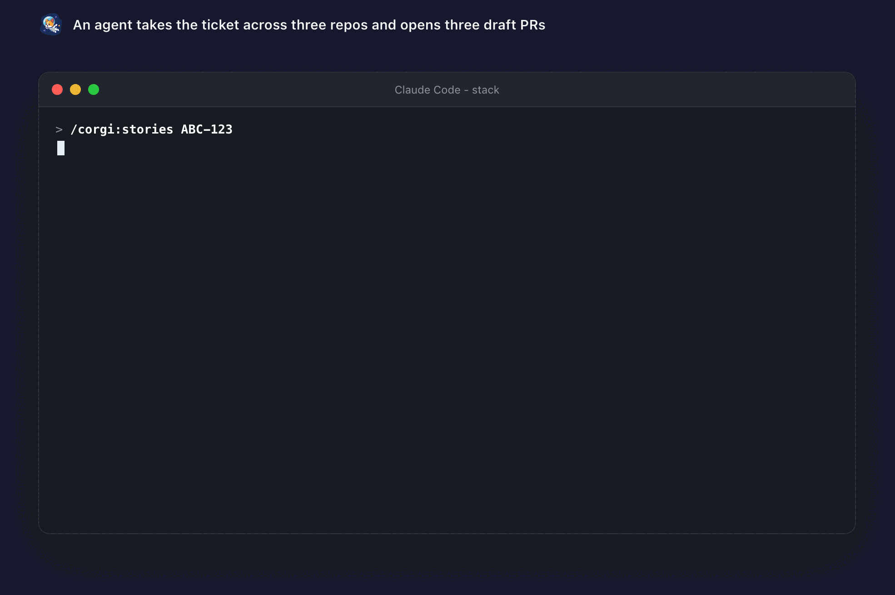

# Let an agent take a whole ticket

Give an agent a corgi workspace and it has what it usually lacks: every repo, databases with real data, the env between services, and a way to start the whole thing. So it can read a ticket, change three services, run the stack to check the result, and open a draft PR in each repo.

```text
tracker ticket ABC-123
   │
   ▼
agent reads the whole workspace
   ├─ edits  api/  ·  web/  ·  mobile/
   ├─ corgi run --detach      boots the real stack (seeded DBs, wired env)
   ├─ corgi status --ready    waits until healthy, then tries the feature
   └─ draft PR per repo  ──►  you review, you merge
```

[Install corgi](install.md), then add the [Claude Code](https://claude.com/claude-code) plugin (other agents: `npx skills add Andriiklymiuk/corgi`):

```
/plugin marketplace add Andriiklymiuk/corgi
/plugin install corgi@corgi
```

Two optional mods ride along - live pieces of the Claude Code screen, not skills ([what they do](sessions.md#inside-claude-code-the-mods)):

```
/plugin install corgi-band@corgi     # band: sessions waiting on you + what this turn posted, /corgi board pane
/plugin install corgi-guard@corgi    # stops the Bash shapes corgi runs lose turns to, adds the corgi fix
```

Slash-commands and plain English both work:

```
/corgi:align "move auth to api"  "make sure we agree before you touch anything"
/corgi:idea                     "write a spec for checkout, give me a link for the team"
/corgi:stories ABC-123          "build a referral program across the services"
/corgi:review <pr-url>          "fix the comments on this MR and answer them"
/corgi-run                      "run the todo stack, then show me the logs"
/corgi-tracker                  "how's the team doing - anything stuck?"
/corgi-queue                    "I just joined - what should I pick up first?"
/corgi-debug                    "the api is 500ing, find out why"
/corgi-complexity               "this handler branches like a jungle - simplify it"
/corgi-risk <pr-url>            "how much review does this need - can it be auto-approved?"
/corgi:setup                    "set corgi up for me: agent, phone, Telegram, menu bar, Stream Deck"
/corgi:showcase                 "make README gifs of the new feature"
```

Ask once, then ship: `align` looks the code up itself, asks only the questions that change the work - at most five, each with a recommended answer - and says "Aligned. Going." when there are none. Nothing ships without you. It opens **draft** PRs and waits. If you have no project to try this on, `corgi run -l` fetches an example.

<p align="center"></p>
<p align="center"><sub>An agent takes the ticket across three repos and opens three draft PRs.</sub></p>

corgi is built to be driven by a program: it never stops to ask a question, prints JSON with `--json`, and returns exit codes you can branch on (`0` ok, `1` failed, `2` bad usage). It also ships an **MCP server**, so an agent calls real tools instead of guessing shell commands:

```bash
corgi mcp                        # stdio, local, no network - point any MCP client at it
corgi mcp --http :8765 --tunnel  # remote: a bearer-token-protected public URL
```

More: [agents & scripting](agents.md) · [MCP server](mcp.md) · [planning from your tracker](tracker.md).

---

[← Back to the README](../README.md)
