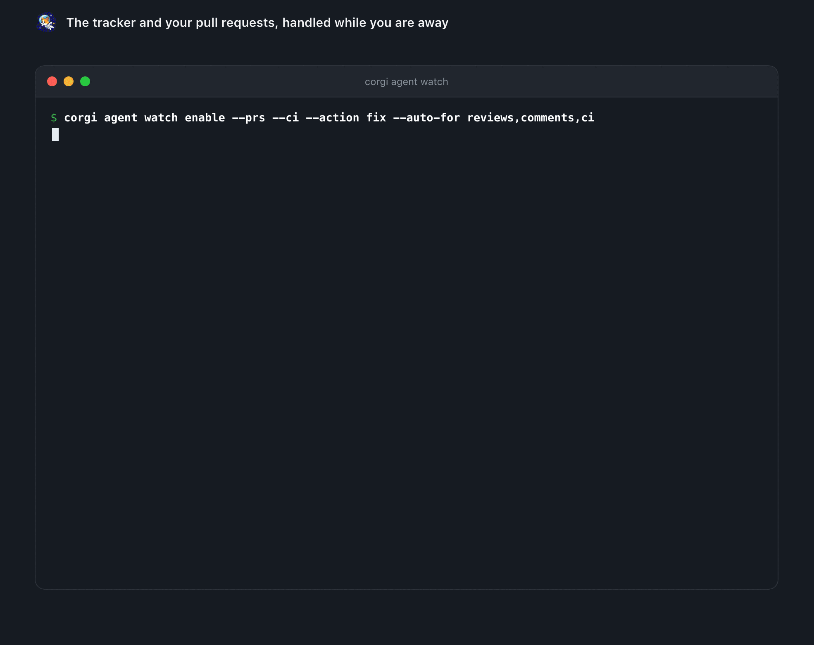
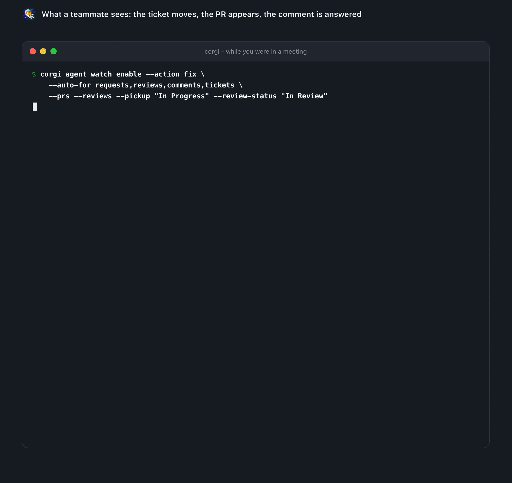
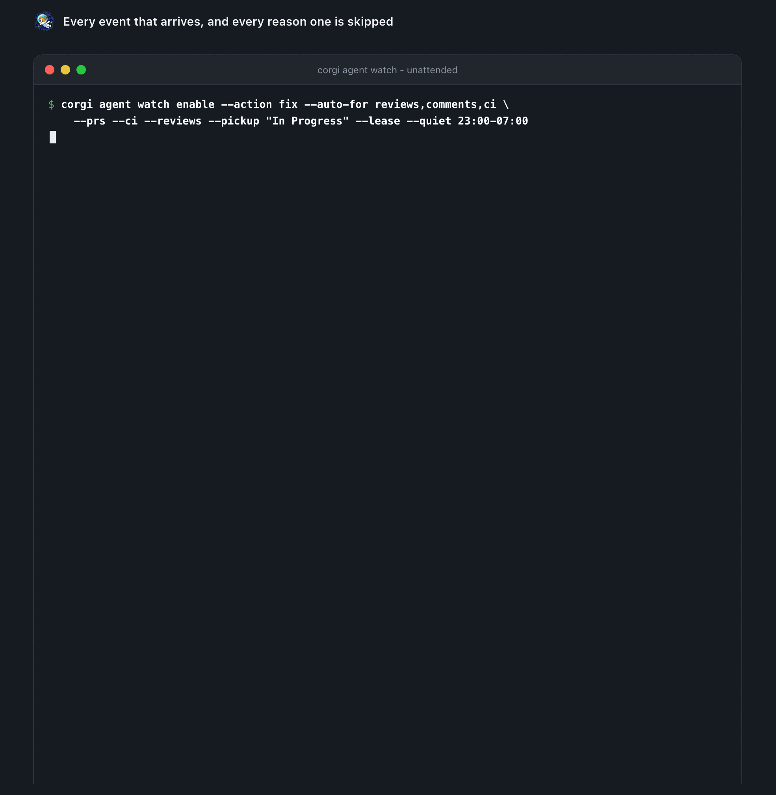
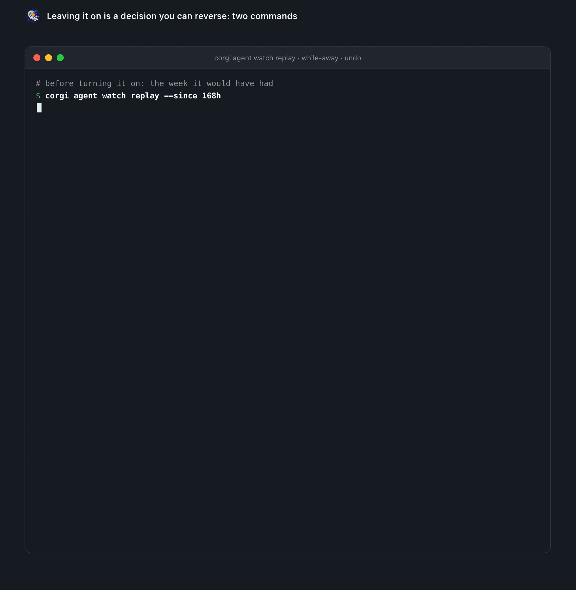
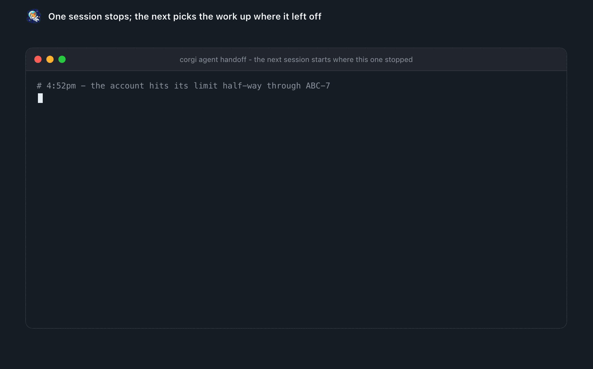
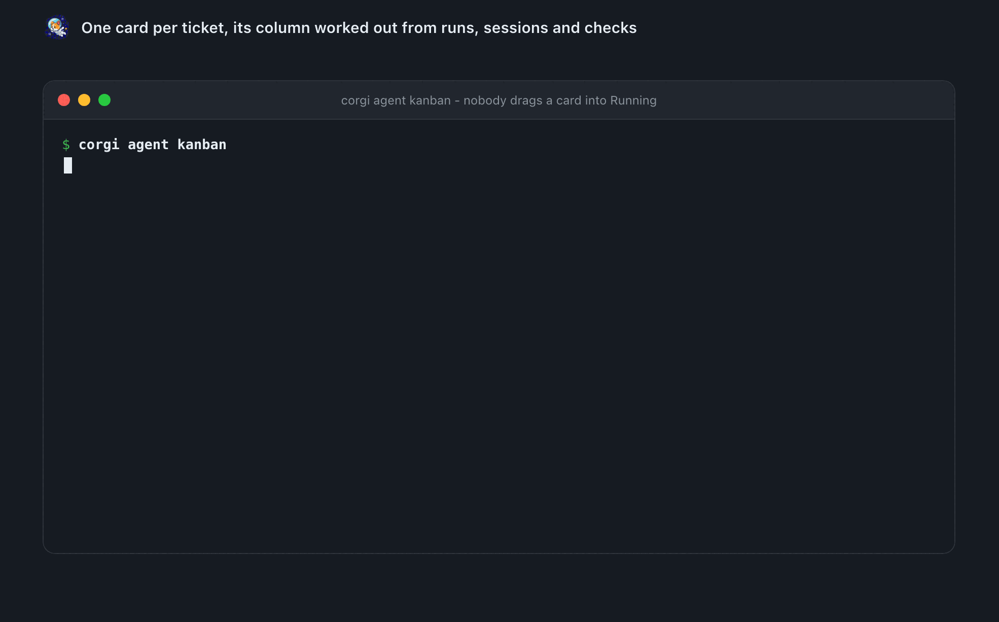

# Work that gets done while you are away

## Work that arrives while you are away

`corgi agent watch` has the daemon
poll Linear or Jira and GitHub or GitLab, with a saved cursor, so a round
that finds nothing costs one request and no agent tokens. A new bug
assigned to you, a comment on it, a review on your PR: you get the
notification, and with `--action fix` a headless Claude runs the matching
skill in the workspace and opens draft PRs. Webhooks (`corgi agent watch
hooks`) make it instant. Details in
[docs/agent.md](agent.md#watching-the-tracker-and-your-pull-requests).

<p align="center"></p>

## An agent that works while you do not

`--auto-for` decides what it takes
on its own, and the point is that it is a choice per kind rather than all or
nothing:

```bash
corgi agent watch enable --action fix --auto-for tickets,reviews,comments,ci \
  --prs --ci --reviews --lease --quiet 23:00-07:00 --days-off weekends \
  --pickup "In Progress" --review-status "In Review"
```

`--quiet` is the night: nothing starts and nothing rings, one summary when it
opens. `--days-off weekends` (or any days: `sat,sun`, `mon,fri`) is the
weekend: the watch sleeps through the day - the tracker is not even polled -
and what arrived is in the inbox and rings once on the next working day.

<p align="center"></p>

A ticket assigned to you moves itself twice: to **In Progress** when a run
takes it, and to **In Review** once that run has opened a pull request, with
the link posted on the ticket. Each finished run also reaches wherever
`notifyUrl` points - Telegram, Slack, ntfy - with the pull request as the link,
and is kept in `corgi agent while-away` for the morning.

- **review comments** and **red builds** are the safest to hand over: both are
  already scoped, and a build brings its own test for "done".
- **a fresh ticket** is a blank page - leave it reporting until the rest has
  earned trust. It waits in the inbox with a *Work on it* button that hands it
  to a session you can watch.
- **someone else's pull request** needs `--reviews` to reach you at all and is
  never worked on unattended: corgi reads it and posts a review, and will not
  push to their branch.

<p align="center"></p>

Every unattended run reviews its own diff before it reports, stamps the pull
request with where it came from, and is capped by what a run on that workspace
usually costs rather than by a count. What it will not do is as deliberate: a
comment on a ticket that is already done, a ticket closed as a duplicate, four
comments on one pull request, or a ticket another machine has claimed
(`--lease`). [`corgi agent watch replay`](agent.md#a-dry-run-you-can-read) shows the
week it *would* have had before you turn it on, and
[`corgi agent watch undo`](agent.md#after-the-fact) puts a run back.

<p align="center"></p>

## A workspace says what it wants done on its own

Switches, each off until
you flip it, each taking effect on the daemon's next round - from the CLI or
the phone: `--auto-allow reads` answers a Read/Grep/Glob prompt itself (never
Bash, never a write); `--done-when "go test ./..."` runs the checks when a
session stops with changes and types a red one back - *done* means the tests
say so; `--compact-at 85` sends `/compact` to a full session when it stops;
`--rebase` rebases a stopped session's clean branch when main moved (a branch
that would conflict is told which files under `--hand-over`); `--lessons`
writes down reviews on your PRs, red checks and failed bots for every new
session to read. `watch work --attempts 3 --models opus,sonnet` tries a
ticket three ways in three worktrees; `corgi agent attempts` compares and
picks. A bot run that fails retries a model up; `bot show` sums its ledger.
Another agent's CLI joins the board through `corgi agent event`; a
teammate's phone pairs read-only with `corgi agent up --viewer`.

Full setup - every flag, what it refuses to do and why - in
[docs/agent.md](agent.md#choosing-what-it-does-on-its-own). In a chat with
the corgi plugin, `/corgi:setup` walks it, and asking *"what do we track?"*
answers from the live config and suggests what is missing.

## Work hands itself off

A session that stops half-way - a usage limit, the
end of the day, a carry to another account - leaves a **handoff**: a typed
packet, never a transcript, with what is done, what is not, what was decided,
what to ask, where the code is, and the check that was run. The next run
re-runs that check at the current head before it trusts a word; a new session
on the branch is told to read it first; the ticket carries the same in one
corgi comment that grows instead of a trail of them.

<p align="center"></p>

## One card per ticket, in a column corgi works out

`corgi agent kanban`
(and the phone's Board tab) puts each ticket where the facts put it: Running
because a run or a session is on it, Review because a pull request is open,
Blocked because two runs failed in a row or a run said it needs a credential,
Ready because a handoff or a deferred run is waiting - with the branch, the
pull requests and what it has cost so far. A card in Review says how its
pull request stands - checks green, approved - and *ready to merge* once
nothing is left between it and the button (`pull` on the card, the inbox
row and `corgi agent watch --json`; read from GitHub or GitLab once a round).
Two switches close the loop without you: `corgi agent watch enable
--hand-over` types a review comment or a red build into the session already
on that branch, and `--auto-merge` merges what the forge calls ready. A bot
can act on its own too - `corgi agent bot add reviewer --template reviewer`
reviews every pull request someone asks you about, as itself.

<p align="center"></p>
<p align="center"><sub>One card per ticket, its column worked out from runs, sessions and checks.</sub></p>

## A board that stays current, and a history behind it

A Running card
carries a live line - *now: Edit cmd/x.go · sonnet-4-5* - and every card
says who worked on it: the runs, the sessions, the tokens, the dollars, the
models and the agents (claude, codex). The dollars are Claude Code's own
estimate at API prices (≈$): on a subscription nothing is billed per run, and
the tokens are what a run really spends. Several cards that make one thing -
a plan's tasks, the subtasks of one parent ticket - show as a *feature*
above the columns, with its state and the order they run in: `TASK-1 →
TASK-2 + TASK-3 → TASK-4` says two go in parallel after the first. Done is
hidden by default on the phone, the menu bar, the editor and the page; a
switch shows it. Once an hour the daemon lets go of what is over: a Done
card after a day, a run that answered a week ago with nothing since, a
review whose pull request closed, a ticket nothing touched for two weeks
(`corgi agent kanban reconcile --dry-run` says what would leave; `--back
ABC-12` puts one back; anything new about the ticket brings its card back
by itself). What left is not lost: `corgi agent history` is the timeline -
every run with what it said, its cost and model, every merge, every finished
task, every card that left and why, day by day; `--kind merged` (or run,
done, canceled, left) keeps one kind; `--json` and `/launch/history?kind=`
for the apps.

## Tasks of your own, on the same board

Not everything comes from a
tracker. `corgi agent task add "Meta SDK on iOS" --workspace app --body "…"` -
or **+ Task for later** on the phone and the page - puts a ticket you wrote
in the inbox and the Inbox column, with a description and the workspace it is
for. **Work on it** opens a session in that checkout with the description as
its prompt; the task moves to Doing at once and the card says *picked from
the phone 1m ago · waiting for a session*, then *session X is working on it*
from the session's first event. The session keeps the board honest as it
goes (`corgi agent task move TASK-3 Review` when the draft PR is up,
`corgi agent task done TASK-3` when there is nothing left), and a task only
leaves the inbox when it is Done or Canceled. Nothing about it reaches a
tracker. The same goes for a tracker ticket you press Work on it on: the card
says who picked it and names the session on it from the first event.

A pull request of yours - one corgi's run opened, one a session on the ticket
opened, or the one an inbox row is about - can be taken out of draft, merged
or closed from the same row, on every surface: `corgi agent watch pr
ready|merge|close ABC-123`. A comment from a bot on your pull request (a
tracker's link, a coverage report) never reaches the inbox, whether it came
by polling or by webhook.

The same release taught the agent a few habits: a **scope** per ticket that
the hooks hold it to (a write outside the agreed paths is refused with the way
to widen, a diff over budget is reported once), a **drift** flag on the key
when the numbers say a session has gone off the rails, **routines** on a clock
(`corgi agent routine add digest`), the **changed surface** at the top of every
pull request, and `corgi agent harden` for the safe defaults. All in
[docs/agent.md](agent.md).

The board itself and its clients: [every session at once](sessions.md).

---

[← Back to the README](../README.md)
